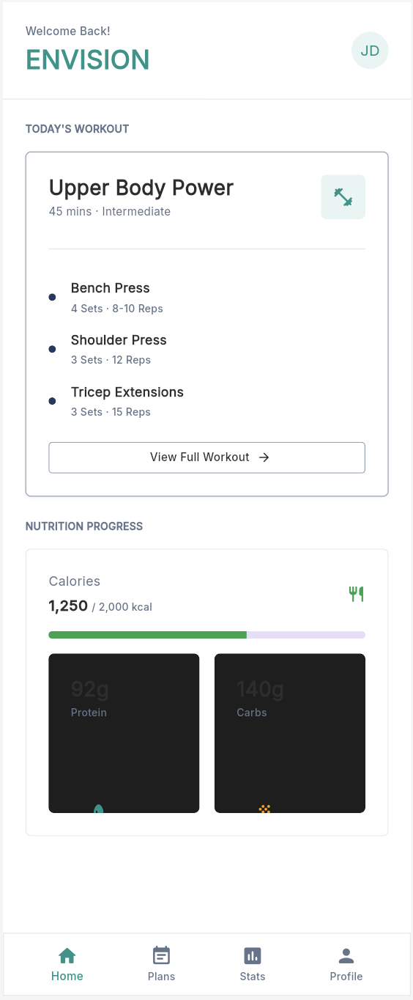
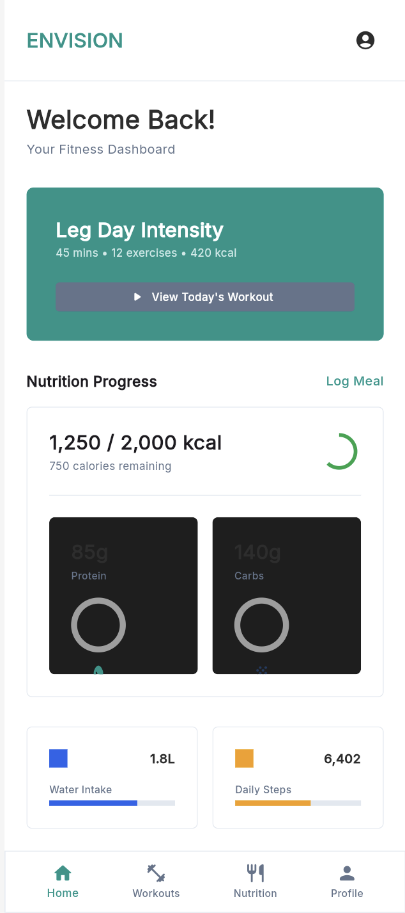

---

### Isaac Gbaba — Workout CTA wording

**A/B Test Name:** “View Today's Workout” versus “Start Today's Workout”.

**User Story Number:** US-04 — View Daily Workout Plan ([issue #5](https://github.com/paulmoura-pixel/Envision/issues/5)).

**Metrics:** Primary: workout access CTR as defined in METRICS.md. Secondary: successful workout-open rate and workouts logged per eligible client. Guardrails: workout load failures and time from CTA click to successful workout display. DAU and seven-day returning-user retention are exploratory context.

**Hypothesis and problem:** Clients may interpret “View” as passive browsing rather than the next action in their training session. Changing only the CTA verb to “Start” may increase the share of workout CTA impressions that lead to a click. This experiment tests wording only; it does not change invitation requirements, code expiry, authorization, workout content, placement, colors, or navigation.

**Experiment using Firebase capabilities:** Read string Remote Config parameter `workout_cta_text`, default `View Today's Workout`. Baseline uses the default; treatment uses `Start Today's Workout`. Fetch and activate configuration before showing the measured CTA, using the baseline as the offline/error fallback. Keep the default unchanged while the test runs. For the course demonstration, expose 100% of eligible installations and assign 50/50 across variants. Use separate Android and web configurations/experiments where supported by the project and verify actual assignment on each platform. If the console cannot target a platform, document that limitation rather than claim an experiment exists. Do not change the currently running `isCodeRequired` experiment to implement this proposal.

**Audience:** Authenticated clients linked to a coach who have an assigned workout for the selected date. Coaches, unlinked accounts, and “no workout scheduled” sessions do not enter the denominator. Invite validation is identical in both groups; an expired, used, invalid, or revoked invite is rejected under the same rules.

**Tracking:** `workout_cta_view`, `workout_cta_click`, `workout_opened`, `workout_logged`, and `workout_load_failed`. Include variant, platform, app version, and non-personal impression/log IDs where applicable. Fire success events after the corresponding load/save succeeds. Deduplicate by impression/log ID. Confirm events appear in Firebase before collecting results. Use an explicit test display of the variant and installation identifier so screenshots demonstrate actual assignment; hide it in normal production UI.

**Variations / mockup specification:**

| Element | Baseline | Treatment |
|---|---|---|
| Workout card title | Today's Workout | Today's Workout |
| Workout data and notes | Same assigned workout | Same assigned workout |
| CTA text | View Today's Workout | Start Today's Workout |
| CTA destination | Assigned workout detail | Assigned workout detail |

Create two screenshots/mockups of this same card with only that text changed before design submission; this table specifies the intended design and is not evidence of an implemented variation.

**Duration and analysis:** Run for 14 days for a future product evaluation; complete the course demonstration using recorded test installations without presenting four testers as conclusive product evidence. Report dates, eligible users/installations per variant, impressions, clicks, CTR, successful opens, logs, and failures. A proposed practical improvement is at least 5 percentage points in CTR without degraded load success. Report uncertainty and extend the study if the sample is insufficient; do not declare a winner from a handful of test sessions. Day-7 retention requires seven days of follow-up.

**Acceptance criteria:** Parameter and fallback work; both rendered variants are verified; every test attempt has platform/variant/installation evidence; event counts reconcile with test actions; no client data or raw invite tokens enter analytics; client–coach access restrictions remain enforced.

Jonathan Conceicao
A/B Test: Daily Workout Access
A/B Test Name
Daily Workout Preview vs. Workout Navigation Button
User Story Number
US-04 — View Daily Workout Plan
Metrics
This A/B test will evaluate three categories from our team’s HEART framework:
1. Task Success 
  Workout Plan Access Rate: Percentage of users who successfully open their assigned workout after accessing the home screen.
  Time to Access Workout: Average time required for users to find and open their assigned workout.
  Workouts Logged: Number of workouts successfully recorded by users.
2. Engagement
  Daily Active Users: Number of unique users interacting with Envision each day.
  Workout Plan Views: Number of times users access their assigned workout plans.
3. Retention
  Average Logins per Week: Average number of times users return to Envision each week.
These measurements align with our HEART goals of helping trainees find their workout plans quickly, regularly interact with the application, and maintain consistent fitness tracking habits.

Hypothesis:
We believe that displaying a preview of the assigned daily workout directly on Envision’s home screen will increase the percentage of users who access their workout plans compared to requiring users to navigate through a separate workout button.
By making workout information immediately visible, we expect users to find their assigned exercises more quickly, potentially improving Task Success and Engagement.

What Problem Are We Trying to Solve, and what's Its Impact?
One of Envision’s primary goals is to simplify the fitness tracking experience by allowing trainees to quickly access personalized workout plans created by their trainers.
However, requiring users to navigate through multiple screens to locate their assigned workouts may create unnecessary friction and discourage consistent application usage.
Our HEART framework emphasizes that students should be able to quickly find their assigned workout plans and successfully log their workouts.
This experiment will help determine whether displaying workout information directly on the home screen improves accessibility and encourages users to interact with their assigned workout plans.

Experiment:
We will use Firebase Remote Config and Firebase A/B Testing to randomly assign eligible users to one of two home-screen variations.

Target Audience:
Trainees who have successfully created an Envision account and have at least one workout assigned by their trainer.

Experiment Distribution:
  50% of eligible users will see Variation A.
  50% of eligible users will see Variation B.
We will use an equal distribution to compare both designs under similar conditions.
Each user will remain assigned to the same variation throughout the experiment.

Experiment Duration:
The experiment will run for approximately two weeks, depending on the number of participating users.
Firebase Analytics Tracking:
We will track the following events:

Firebase Event  // Purpose  // HEART Category
home_screen_view  // Records when a user accesses the home screen.  // Engagement
workout_opened  // Records when a user opens their assigned workout.  // Task Success
workout_logged  // Records when a user successfully logs a workout.  // Task Success
user_login  // Records when a user successfully logs into Envision.  // Retention

Firebase Analytics will also be used to calculate DAU based on user activity.
We will measure the time between the home_screen_view and workout_opened events to evaluate how quickly users can access their assigned workout plans.

Success Criteria:
We will consider Variation B more successful if:
  1. A higher percentage of users successfully open their assigned workout plans.
  2. Users take less time to access their workouts.
  3. Workout logging activity remains consistent or improves.
We will also monitor DAU and average logins per week to identify potential changes in Engagement and Retention.
If the experiment has too few participants to produce reliable results, we will treat the findings as preliminary.

Variations: 

Variation A — Workout Navigation Button (Control)
The home screen displays a button labeled “View Today’s Workout.”
Users must select this button to navigate to their assigned workout plan.

Variation B — Daily Workout Preview (Test)
The home screen displays a preview of the assigned workout, including its name and exercises.
Users can select the preview to access their complete workout plan.

Expected Outcome:

We expect Variation B to improve Task Success by reducing the time required for trainees to locate their assigned workouts.
We also expect the workout preview to encourage more frequent interaction with workout plans, potentially improving Engagement.
The experiment will help our team determine which home-screen design better supports the goals established in Envision’s HEART framework.

###################################################################################################################################################################

Paul Moura A/B Test: # A/B Test: Guided Workout Checklist vs. Standard Workout View

**User Story Number:** US-04 --- View Daily Workout Plan\
**Priority:** High\
**Feature:** Daily Workout Dashboard

## Metrics

This A/B test will evaluate three categories from our team's HEART
framework: Task Success, Engagement, and Retention.

### 1. Task Success

-   **Workout Completion Rate:** Percentage of users who start a workout
    and successfully complete all assigned exercises.
-   **Workout Logging Rate:** Percentage of completed workouts that are
    successfully logged in Envision.
-   **Time to Complete Workout Logging:** Average time between
    completing a workout and successfully recording it in the
    application.

### 2. Engagement

-   **Workout Start Rate:** Percentage of users who view their daily
    workout plan and begin exercising.
-   **Workout Completion Events:** Total number of workouts completed
    and recorded by users.
-   **Daily Active Users (DAU):** Number of unique users interacting
    with Envision each day.

### 3. Retention

-   **Average Logins per Week:** Average number of times users log into
    Envision each week.
-   **Weekly Returning Users:** Percentage of users who return to
    Envision within seven days of their previous session.

These measurements align with our HEART goals of helping trainees
complete their assigned workouts, consistently record their fitness
activity, and continue using Envision over time.

## Hypothesis

We believe that adding an interactive workout checklist will increase
the percentage of users who complete and log their assigned workouts
compared to displaying the workout plan as a standard list of exercises.
By allowing users to check off exercises as they complete them, we
expect the workout process to feel more organized and easier to follow.
This may improve Task Success and Engagement while encouraging users to
return to Envision for future workouts.

## What Problem Are We Trying to Solve, and What Is Its Impact?

One of Envision's primary goals is to connect trainees with their
trainers and make following personalized workout plans easier. However,
users may have difficulty keeping track of which exercises they have
completed, especially when a workout includes multiple exercises, sets,
and repetitions. Users may also forget to log their workouts after
exercising.

Our HEART framework emphasizes helping trainees successfully complete
their workouts and maintain consistent fitness-tracking habits. This
experiment will help determine whether an interactive checklist reduces
friction during workouts and encourages users to record their completed
exercises. Improving this process could increase workout completion,
improve the accuracy of fitness records, and encourage users to continue
using Envision.

## Experiment

We will use Firebase Remote Config and Firebase A/B Testing to randomly
assign eligible users to one of two workout-screen variations.

-   **Target Audience:** Trainees who have successfully created an
    Envision account, logged in, and have at least one workout assigned
    by their trainer.
-   **Experiment Distribution:** 50% of eligible users will see
    Variation A, and 50% will see Variation B. Each user will remain
    assigned to the same variation throughout the experiment.
-   **Experiment Duration:** Approximately two weeks, depending on the
    number of eligible participants and the amount of data collected. If
    the sample size is too small, the experiment may need to run longer.

## Firebase Analytics Tracking

  -----------------------------------------------------------------------
  Firebase Event          Purpose                 HEART Category
  ----------------------- ----------------------- -----------------------
  `user_login`            Records successful user Retention
                          logins.                 

  `home_screen_view`      Records when a user     Engagement
                          accesses the home       
                          screen.                 

  `workout_opened`        Records when a user     Task Success
                          opens an assigned       
                          workout.                

  `workout_started`       Records when a user     Engagement
                          begins a workout.       

  `exercise_completed`    Records when a user     Task Success
                          marks an exercise as    
                          completed.              

  `workout_completed`     Records when all        Task Success
                          required exercises are  
                          completed.              

  `workout_logged`        Records when a workout  Task Success
                          is successfully saved.  

  `user_logout`           Records when a user     Engagement
                          logs out.               
  -----------------------------------------------------------------------

Firebase Analytics will be used to calculate workout start rates,
workout completion rates, workout logging rates, daily active users
(DAU), and weekly returning users. We will also measure the time between
`workout_opened` and `workout_logged` to understand how efficiently
users complete and record their workouts.

## Variations

### Variation A --- Standard Workout View (Control)

The user sees their assigned daily workout as a standard list containing
exercise names, sets, repetitions, and coach notes. Users complete the
workout and log it using the existing workflow.

### Variation B --- Interactive Workout Checklist (Test)

The user sees the same assigned workout information, but each exercise
includes an interactive checkbox or completion button. Users can mark
exercises as completed as they progress through the workout. Once all
required exercises are complete, the interface prompts the user to log
the workout.

Both variations will provide the same workout information and logging
functionality. The primary difference will be the interactive checklist
and completion guidance.

## Success Criteria

We will consider Variation B more successful if:

1.  **Higher Workout Completion Rate:** A greater percentage of users
    who start a workout finish all assigned exercises.
2.  **Higher Workout Logging Rate:** A greater percentage of completed
    workouts are successfully saved in Envision.
3.  **Improved Engagement:** More users start and complete their
    assigned workouts.
4.  **Maintained or Improved Retention:** Weekly returning users and
    average logins per week remain consistent or increase.
5.  **No Significant Usability Problems:** The checklist does not
    introduce additional errors, confusion, or unnecessary time spent
    navigating the workout.

The team will compare the results of both variations using Firebase
Analytics. We will also consider the number of participants and
statistical confidence before determining whether the test supports the
hypothesis.

## Expected Outcome

We expect Variation B to improve Task Success by helping trainees track
their progress throughout a workout and remember to record completed
exercises. The interactive checklist may also improve Engagement by
making the workout process more structured and encouraging users to
complete their assigned exercises. If successful, the results will help
the Envision team determine whether guided workout completion should
become the standard workout experience.

############################################################################################################################################################################################################################################

Dominic Baez
A/B Test: Account Creation
A/B Title: Coach Code vs. No Coach Code
User Story: US-03 Profile Creation

# Envision A/B Test: Skippable Trainer Code in Profile Setup

## Metrics

### 1. Task Success
- **Profile Completion Rate:** Percentage of new users who save a valid profile during their first session.
- **Time to Complete Profile:** Average time between starting profile setup and saving a valid profile.
- **Trainer Code Entry Rate:** Percentage of new users who successfully enter their trainer's code.

### 2. Engagement
- **Daily Active Users:** Number of unique users interacting with Envision each day.
- **Workout Plan Views:** Number of times new users open their assigned workout plans after finishing their profile.

### 3. Retention
- **Average Logins per Week:** Average number of times users return to Envision each week.
- **Day-7 Retention:** Percentage of new users who return to Envision 7 days after signing up.

These measurements align with our HEART goals of helping trainees set up their accounts quickly, connect with their trainers, and build consistent fitness tracking habits from their first session.

## Hypothesis

We believe that letting users skip the trainer code step during profile setup will increase the percentage of new users who complete their profile compared to requiring the code. Users who do not have their code on hand at signup will no longer get stuck or abandon the app, so we expect higher Task Success and Engagement. We also expect most skippers to add their code later, so the trainer link rate should not drop meaningfully.

## What Problem Are We Trying to Solve, and What's Its Impact?

The profile flow already uses short steps, but the trainer code step is required. A new user who does not have their code yet (for example, the trainer has not sent it) cannot finish setup and may leave before ever reaching a workout. Every abandoned setup is a lost user who never logs a workout. This experiment will show whether removing that hard stop improves completion without hurting how many trainees end up connected to their trainers.

## Experiment

We will use Firebase Remote Config and Firebase A/B Testing to randomly assign eligible users to one of two versions of the trainer code step.

- **Variation A (Control):** Trainer code step is required to finish profile setup.
- **Variation B (Treatment):** Trainer code step includes a "Skip for now" option. Skippers can enter their code later from their profile, with a reminder on the home screen.

Everything else stays the same in both variations: the profile prompt appears within 2 seconds, the trainer code prompt within 3 seconds, and validation and network error messages appear within 2 seconds with the option to retry.

## Target Audience

New users who have successfully created an Envision account and are logging in for the first time.

## Experiment Distribution

- 50% of eligible users will see Variation A.
- 50% of eligible users will see Variation B.

We will use an equal distribution to compare both designs under similar conditions. Each user will remain assigned to the same variation throughout the experiment.

## Experiment Duration

The experiment will run for approximately two weeks, or until about 1,500 users per variation have participated, whichever takes longer. Two full weeks captures weekday and weekend behavior, and Day-7 metrics need a full week of follow-up after the last user enters.

## Firebase Analytics Tracking

We will track the following events:

| Firebase Event | Purpose | HEART Category |
|---|---|---|
| `profile_setup_start` | Records when a new user begins profile creation. | Task Success |
| `trainer_code_prompt_view` | Records when the trainer code step is shown. | Engagement |
| `trainer_code_entered` | Records when a valid trainer code is submitted (parameter: `source` = `setup` or `later`). | Task Success |
| `trainer_code_skipped` | Records when a user taps "Skip for now" (Variation B only). | Task Success |
| `profile_setup_complete` | Records when a user saves a valid profile (parameters: `duration_sec`, `trainer_code_entered`). | Task Success |
| `workout_opened` | Records when a user opens their assigned workout. | Engagement |
| `user_login` | Records when a user successfully logs into Envision. | Retention |

Firebase Analytics will also be used to calculate DAU based on user activity. We will measure the time between `profile_setup_start` and `profile_setup_complete` to evaluate how quickly users finish setup, and the share of skippers who later fire `trainer_code_entered` with `source = later`.

## Success Criteria

We will consider Variation B more successful if:

- A higher percentage of users complete their profile.
- Users take the same or less time to finish setup.
- The trainer code linked rate by Day 7 stays consistent or within an acceptable drop (for example, no more than 5 percentage points below Variation A).
- Workout plan views and workouts opened remain consistent or improve.

We will also monitor DAU, Day-7 retention, and average logins per week for changes in Engagement and Retention. If B raises completion but many skippers never add their code, we will investigate stronger reminders before shipping. If the experiment has too few participants to produce reliable results, we will treat the findings as preliminary.

